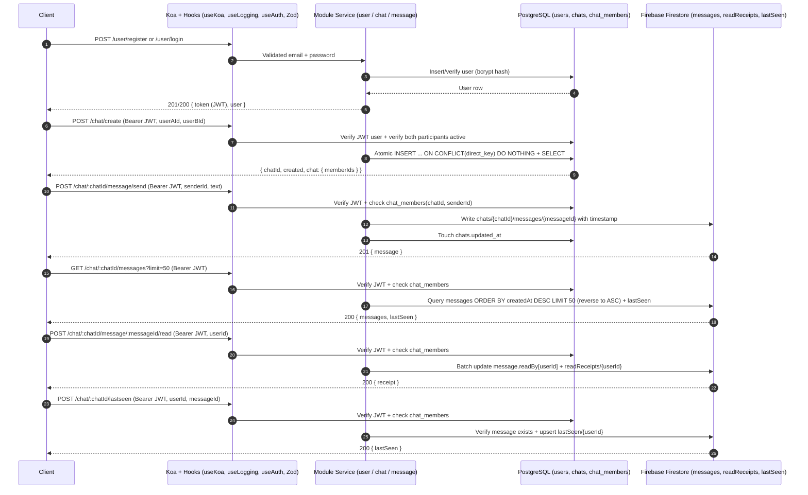

# ChatFlow Backend — Architecture & Data Flow Guide

Share this guide alongside [docs/api-reference.json](./docs/api-reference.json) and [docs/chatflow.postman_collection.json](./docs/chatflow.postman_collection.json) so anyone reviewing or integrating with the project can understand how every layer interacts.

---

## 1. End-to-End Request & Data Flow



---

## 2. How Layers Interact Internally

1. **Transport & Root Boundary (`src/app.ts`, `src/lib/hooks/use-koa/useKoa.ts`)**
   - Handles CORS, JSON/multipart body parsing, and catches both `AppError` subclasses (`400`, `401`, `403`, `404`, `409`) and unexpected errors (`500`).
2. **Composable Hooks (`src/lib/core/compose.ts`, `src/lib/hooks/*`, `src/core/hooks/useAuth.ts`)**
   - Each endpoint declares its middleware pipeline explicitly: `useKoa → useServices → useLogging → useAuth → Zod validators → handler`.
   - Validation failures throw `BadRequestError` (`400`) with exact Zod field paths (`error.details`).
   - JWT failures throw `NotAuthenticatedError` (`401`); inactive users or non-members throw `NotAuthorizedError` (`403`).
3. **Database Split**
   - **PostgreSQL (`src/core/database/index.ts`, `database/schema.sql`)**: Source of truth for `users`, `chats`, and `chat_members`. Enforces unique `email`/`username`, unique 1:1 `direct_key`, and foreign-key integrity.
   - **Firebase Firestore (`src/core/firestore/index.ts`, `src/modules/message/schema.ts`)**: Source of truth for messages, read receipts, and last-seen tracking per chat.

---

## 3. Sharing & Testing Checklist

1. Give the recipient:
   - The repository (excluding `.env` and `creds.json` — share secrets securely via env vars).
   - [README.md](./README.md) for setup and scripts.
   - [docs/api-reference.json](./docs/api-reference.json) for `curl` examples, request/response schemas, and step-by-step data flow.
   - [docs/chatflow.postman_collection.json](./docs/chatflow.postman_collection.json) for one-click import into Postman/Insomnia/Thunder Client.
2. Run locally:
   ```bash
   npm install
   npm run dev
   ```
3. Verify code & tests before sharing:
   ```bash
   npm run validate
   ```
